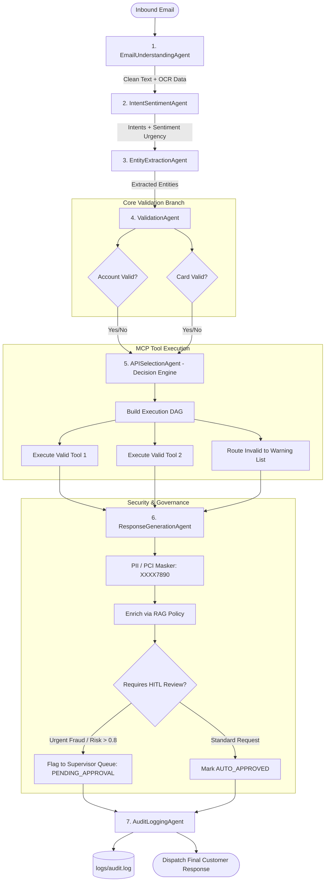

# Agent Workflow & Orchestration Specification
## HDFC Bank - Autonomous Customer Email Resolution System

---

### 1. Executive Summary
The workflow orchestrator coordinates 7 autonomous micro-agents using an immutable state machine blackboard (`WorkflowState`). Each agent executes a focused, deterministic transformation, records its step latency, and appends to the audit trail before delegating to the next stage in the pipeline.

---

### 2. End-to-End Orchestration DAG

---

### 3. Agent Communication & Data Exchange Matrix

| Stage | Producer Agent | Consumer Agent | Transferred Data Payload | Validation / Fail-Safe Rule |
| :--- | :--- | :--- | :--- | :--- |
| **Stage 1** | `EmailUnderstandingAgent` | `IntentSentimentAgent` | Sanitized body string + extracted OCR attachment text + language | Non-empty string; strip script tags |
| **Stage 2** | `IntentSentimentAgent` | `EntityExtractionAgent` | Detected `IntentType` enum list, `is_multi_intent`, `is_urgent` flag | Minimum intent confidence threshold (0.70) |
| **Stage 3** | `EntityExtractionAgent` | `ValidationAgent` | `account_number`, `card_number`, `transaction_count`, `period` | Luhn check / Regex digit verification |
| **Stage 4** | `ValidationAgent` | `APISelectionAgent` | `AccountValidationResult`, `CardValidationResult` | Independent status isolation (`VALID` vs `INVALID`) |
| **Stage 5** | `APISelectionAgent` | `ResponseGenerationAgent` | Structured backend API JSON payloads from MCP tools | Fail-soft: Never crash if one tool fails |
| **Stage 6** | `ResponseGenerationAgent` | `AuditLoggingAgent` | Masked customer letter, disclaimer, sentiment, HITL risk flag | PII Masker ensures 0 unmasked raw numbers |
| **Stage 7** | `AuditLoggingAgent` | Client / Terminal | Completed `WorkflowState` object, total latency SLA | Record JSON log line in `logs/audit.log` |

---

### 4. Detailed Handling of Business Scenarios

#### Scenario 1: Account Balance Enquiry
- **Incoming**: `"Please provide my savings account balance for account number 1234567890."`
- **Resolution**: Single intent (`ACCOUNT_BALANCE`), valid account -> `GetAccountBalanceAPI` -> Masked `XXXX7890`, Available Balance: `INR 1,25,000`.

#### Scenario 2: Credit Card Usage Enquiry
- **Incoming**: `"Please share my last 5 credit card transactions for card 4567XXXX8901."`
- **Resolution**: Single intent (`CREDIT_CARD_USAGE`), card verified -> `GetCardTransactionsAPI(limit=5)` -> Formatted bulleted transaction list.

#### Scenario 3: Bank Statement Request
- **Incoming**: `"Kindly send my bank statement for April 2026."`
- **Resolution**: Single intent (`STATEMENT_REQUEST`), period `April 2026` extracted -> `GetStatementAPI` -> Secure download URL & Statement reference ID.

#### Scenario 4: Compound Multi-Intent Inquiries
- **Incoming**: `"Please share my account balance for account 1234567890 and also send last 3 transactions of my credit card 987654321."`
- **Resolution**: Both intents detected (`is_multi_intent=True`), both credentials validated -> Concurrent MCP tool dispatch -> Single cohesive customer response covering both products.

#### Scenario 5: Partial Validation Failure
- **Incoming**: `"Please provide balance for account 1234567890 and card transactions for card 999999999."`
- **Resolution**: Account is `VALID`, card is `INVALID`. System delivers account balance, clearly informs customer that the card could not be validated, and requests them to verify and resubmit card details.

#### Scenario 6: Urgent Fraud Escalation
- **Incoming**: `"URGENT: I see an unauthorized charge on card 4567XXXX8901. Please check transactions immediately!"`
- **Resolution**: Detected sentiment `URGENT` / `NEGATIVE`. Priority flag set, empathetic response drafted, and case flagged in supervisor Human-in-the-Loop review queue.

