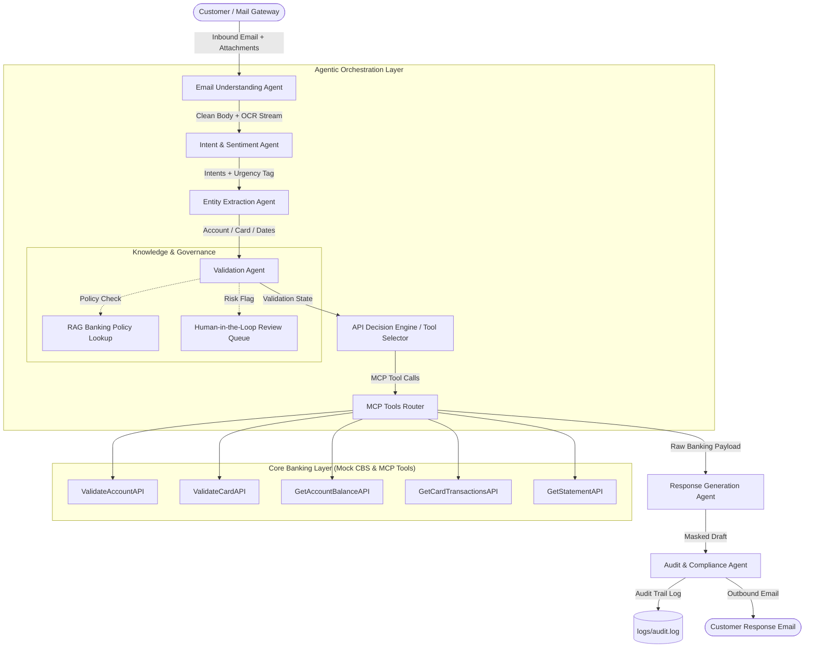
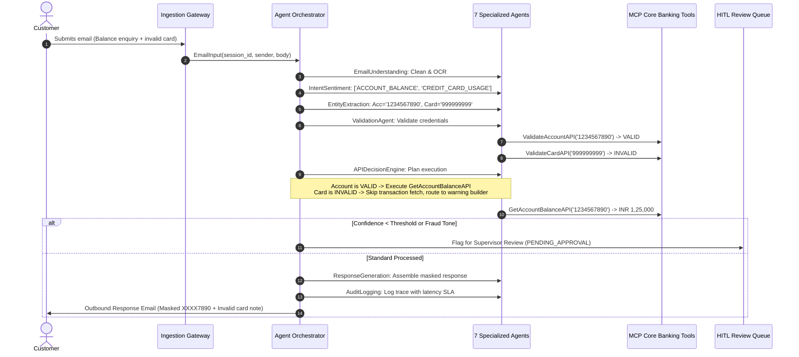

# Solution Architecture Document
## HDFC Bank - Intelligent Email Processing & Customer Response System With MCP

---

### 1. Executive Summary & Problem Context
Modern financial institutions receive thousands of customer communications every business day across diverse channels. Manual triaging requires support personnel to inspect emails, infer customer intents and emotional distress, extract fragmented identifiers, execute multiple read operations across disparate Core Banking Systems (CBS), and draft personalized response emails. This paradigm suffers from high operational expenditure, average turnaround times of 4 to 24 hours, error-prone data entry, and compliance risk regarding sensitive customer data (PII/PCI).

The **HDFC Bank Intelligent Email Processing System** resolves this through an **Agentic AI Architecture** operating over the **Model Context Protocol (MCP)**, powered locally by **LLaMA 3 (via Ollama)**.

---

### 2. High-Level Architectural Flow (C4 Container & Component Model)

---

### 3. Detailed Agent Taxonomy & Responsibilities

| Agent Name | Architectural Role | Technologies & Models | Inputs | Outputs |
| :--- | :--- | :--- | :--- | :--- |
| **Email Understanding Agent** | Ingestion & Ingestion Cleaning | Python Regex, PyMuPDF, Pure-Python PDF stream decompressor | Raw MIME body, PDF/Image attachments | Cleaned text, OCR text stream, language code |
| **Intent & Sentiment Agent** | Semantic Reasoning & Escalation Detection | Local LLaMA 3 (Ollama) / Hybrid SLM Classifier | Cleaned email text | Multi-intent list, primary intent, sentiment, urgency flag |
| **Entity Extraction Agent** | Named Entity Recognition (NER) | Local LLaMA 3 / Structured JSON Regex | Customer text + OCR stream | Account number, card number, txn count, statement period |
| **Validation Agent** | Pre-Flight Identity & Integrity Verification | `ValidateAccountAPI`, `ValidateCardAPI` | Extracted entity bundle | Validation status (`VALID`, `INVALID`, `ERROR`) |
| **API Selection Agent (Decision Engine)** | MCP Orchestration & Dependency Planning | Directed Acyclic Graph (DAG) planner | Validated entities, detected intents | Parallel execution batch, sequence plan |
| **Response Generation Agent** | Controlled Generation & Redaction | Prompt Templates, PII Masker (`XXXX7890`) | Verified CBS responses, partial failure flags | Final customer letter, greeting, masked accounts |
| **Audit & Logging Agent** | Compliance & Traceability | Structured JSON File Logger | Agent state, latencies, session ID | Non-repudiable audit records in `logs/audit.log` |

---

### 4. Sequence Diagram: Multi-Intent Handling & Partial Failure

---

### 5. Enterprise Non-Functional Requirements (NFRs)

#### 5.1 Security & Data Privacy (RBI / PCI-DSS 4.0 Compliance)
- **Zero-Plaintext PII**: Bank account numbers are strictly masked to the last 4 digits (e.g. `XXXX7890`). Credit card numbers are masked according to PCI-DSS (`4567XXXX8901`).
- **No Third-Party Cloud Data Leakage**: By executing LLaMA 3 entirely on-premises via local Ollama (`127.0.0.1:11434`), zero financial customer data or PII traverses public networks.
- **Audit Logging Immutability**: All decisions, agent latencies, and tool dispatches are logged to `logs/audit.log` with unique session identifiers.

#### 5.2 Performance & SLA
- **Target SLA**: Under 500 ms for rule-guided hybrid routing; under 3 seconds for local LLaMA 3 inference.
- **Optimized Generation**: Configured with `temperature: 0.1` and `num_predict: 512` to ensure rapid and deterministic structured JSON output.

#### 5.3 Extensibility & Maintainability
- Adding a new banking product (e.g., Fixed Deposit Enquiry or Loan Status) requires only:
  1. Adding the enum to `IntentType` in `models/schemas.py`.
  2. Registering the new mock API in `apis/mock_core_banking.py`.
  3. Adding the MCP JSON Schema in `apis/mcp_tools.py`.
  No core architectural redesign is necessary.

---

### 6. Section 13 Optional Enhancements Architecture

1. **OCR Attachment Processing (`utils/ocr_reader.py`)**: Automatic text extraction from attached PDF cheques and images with multi-layer fallback (PyMuPDF -> Pure-Python zlib stream decompressor).
2. **Multilingual Support (`utils/language_detector.py`)**: Automatic identification of query language (English, Hindi/Hinglish, Spanish, French) with script and vocabulary detection.
3. **Human-in-the-Loop Governance (`workflows/hitl_manager.py`)**: Risk engine flagging emails with urgent fraud alerts, credential validation failures, or low confidence (<0.80) into an approval queue.
4. **RAG Banking Policy Lookup (`utils/policy_rag.py`)**: Semantic keyword knowledge retriever for regulatory guidelines (RBI Zero Liability, Minimum Average Balance, chargeback timelines).
5. **Omnichannel Voice/IVR Support (`utils/omnichannel_adapter.py`)**: Ingestion bridge converting phone transcripts into automated email responses and generating natural, spoken-text IVR scripts.
6. **Real-Time Visual Monitoring Dashboard (`apis/dashboard.html`)**: Web application providing execution metrics, agent execution traces, and live Ollama connectivity monitoring.

