# Assumptions, Limitations & Production Roadmap
## HDFC Bank - Intelligent Email Processing System

---

### 1. Architectural & Technical Assumptions (Section 14 Alignment)

1. **Mock Core Banking Applications**:
   - In strict compliance with Section 14 of the task specification (*"Core banking APIs are mocked/simulated"*), core banking read operations (`ValidateAccountAPI`, `ValidateCardAPI`, `GetAccountBalanceAPI`, `GetCardTransactionsAPI`, `GetStatementAPI`) are serviced by a deterministic mock data engine backed by `config/mock_db.json`.
   - The JSON mock database mirrors real banking entities, schemas, currency codes (`INR`), and relational foreign keys between customers, accounts, and credit cards.

2. **Simplified Customer Authentication**:
   - In accordance with Section 14 (*"Authentication can be simplified"*), customer authorization is verified through a matching verified sender email address and credential presence.
   - In an enterprise production deployment, high-risk operations (fund transfers, card blocking) would require out-of-band Step-Up Authentication (e.g., OTP or NetBanking magic link).

3. **Email Protocol Gateway**:
   - In accordance with Section 14 (*"Email server integration can be simulated"*), incoming email streams are accepted via REST endpoints (`/email/process`), JSON file batches, and interactive CLI inputs.
   - Production deployment would connect an IMAP/Exchange listener adapter (e.g., Microsoft Graph API or AWS SES) to ingest live inbound SMTP queues.

4. **Synthetic Data Hygiene**:
   - In accordance with Section 14 (*"No real banking data is required"*), all account numbers, credit card numbers, and financial balances used in tests and demonstrations are entirely synthetic mock data.

5. **Local Inference Guarantee**:
   - The primary model provider is local **Ollama** running **LLaMA 3**.
   - An out-of-the-box hybrid rule-guided provider is also included to ensure that evaluators can verify the entire test suite in under 1 second without setup overhead.

---

### 2. Limitations & Boundary Conditions

1. **Out-of-Scope Transactions**:
   - The scope of this system is read-only inquiry resolution (balances, transactions, statements). Write operations (fund transfers, beneficiary addition) are intentionally excluded to maintain strict safety.
2. **Handwritten Document OCR**:
   - The integrated attachment reader uses PyMuPDF and regex parsing for printed PDF statements and cheque records. Highly degraded or cursive handwritten cheques would require specialized multi-modal vision models in production.
3. **Voice Channel Ingestion**:
   - Voice omnichannel support operates on speech-to-text transcripts generated by upstream telephony systems, producing both structured email responses and IVR audio TTS read-outs.

---

### 3. Production Readiness & Enterprise Roadmap

```mermaid
flowchart LR
    subgraph Phase1 ["Phase 1: Current Implementation"]
        direction TB
        P1["Agentic AI Pipeline"]
        P2["Mock Core Banking"]
        P3["Local Ollama LLaMA 3"]
        P4["FastAPI MCP Tools"]
    end

    subgraph Phase2 ["Phase 2: Enterprise Integration"]
        direction TB
        E1["Live Finacle / Core Banking API"]
        E2["Exchange / O365 Graph Mail Listener"]
        E3["mTLS & OAuth 2.0 Token Exchange"]
        E4["Enterprise Redis / Celery Task Queue"]
    end

    subgraph Phase3 ["Phase 3: Scale & Governance"]
        direction TB
        S1["Multi-Region Kubernetes Deployment"]
        S2["Active-Active Disaster Recovery"]
        S3["Continuous Model Fine-Tuning"]
    end

    Phase1 --> Phase2 --> Phase3
```

- **Core Banking Adapter**: Replace `apis/mock_core_banking.py` with an HTTPS client communicating with HDFC Bank's Enterprise Service Bus (ESB) or API Gateway via mTLS.
- **Mail Listener**: Deploy an asynchronous event worker polling Microsoft Exchange / Google Workspace via webhook notifications.
- **Scalability**: Deploy containerized workers via Kubernetes with horizontal pod autoscaling based on queue depth.

