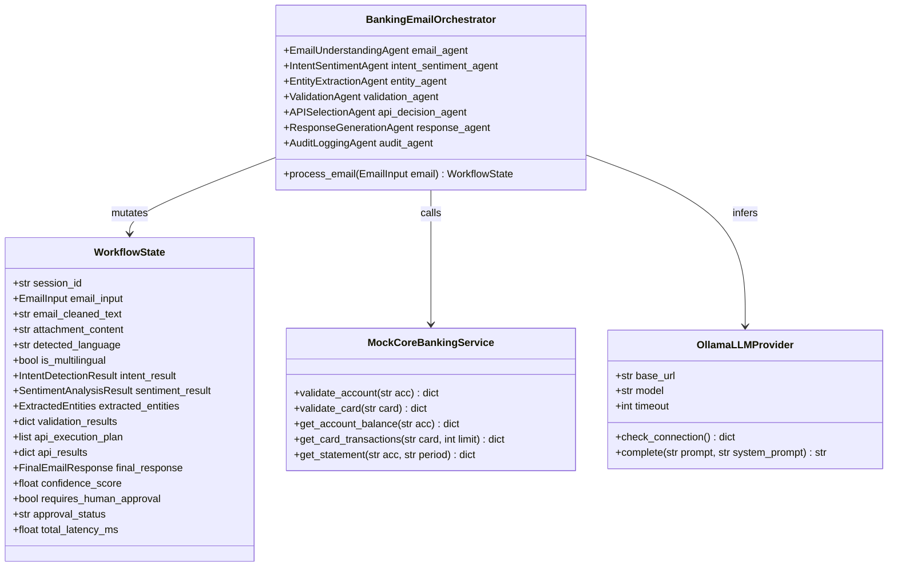
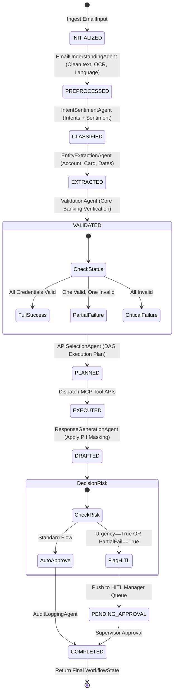

# Low-Level Design (LLD) Document
## HDFC Bank - Intelligent Email Processing System

---

### 1. Package & Module Architecture
The codebase follows clean architecture principles with strict layer boundaries:

```
email_automation/
├── agents/             # Autonomous agent implementations (Single Responsibility)
│   ├── email_understanding_agent.py
│   ├── intent_sentiment_agent.py
│   ├── entity_extraction_agent.py
│   ├── validation_agent.py
│   ├── api_selection_agent.py
│   ├── response_generation_agent.py
│   └── audit_agent.py
├── apis/               # Mock core banking layer & MCP tool contracts
│   ├── mock_core_banking.py
│   ├── mcp_tools.py
│   └── dashboard.html
├── models/             # Strongly typed Pydantic V2 domain models
│   ├── schemas.py
│   └── llm_provider.py
├── prompts/            # Grounded system prompts & few-shot examples
│   └── templates.py
├── workflows/          # State orchestration graph & HITL risk governance
│   ├── state.py
│   ├── orchestrator.py
│   └── hitl_manager.py
├── utils/              # Cross-cutting concerns & compliance
│   ├── security_masker.py
│   ├── ocr_reader.py
│   ├── policy_rag.py
│   ├── language_detector.py
│   ├── omnichannel_adapter.py
│   └── logger.py
└── config/             # Environment & mock data store
    ├── settings.py
    └── mock_db.json
```

---

### 2. Class Diagram



---

### 3. State Machine & Pipeline Transitions



---

### 4. Core Agent Method Specifications

#### 4.1 `EmailUnderstandingAgent.process(email_input: EmailInput) -> Dict[str, Any]`
- **Input**: `EmailInput` (contains `body`, `attachment_paths`).
- **Logic**: Strips trailing carriage returns, collapses redundant whitespace, reads attachments via `extract_text_from_attachment()`, and detects query language.
- **Output**: Dictionary with `clean_body`, `attachment_text`, `combined_content`, `language`, `is_multilingual`.

#### 4.2 `IntentSentimentAgent.process(text: str) -> Tuple[IntentDetectionResult, SentimentAnalysisResult]`
- **Input**: Preprocessed combined email text.
- **Logic**: Sends prompt with strict JSON schema to `OllamaLLMProvider`. Determines whether single or multiple intents exist (`ACCOUNT_BALANCE`, `CREDIT_CARD_USAGE`, `STATEMENT_REQUEST`), and extracts emotional tone.
- **Output**: Structured `IntentDetectionResult` and `SentimentAnalysisResult`.

#### 4.3 `EntityExtractionAgent.process(text: str) -> ExtractedEntities`
- **Input**: Customer text + extracted attachment content.
- **Logic**: Performs regex and NER extraction for 10-digit account numbers, 16-digit card numbers (or masked `4567XXXX8901`), transaction limits, and calendar periods.
- **Output**: `ExtractedEntities` object.

#### 4.4 `ValidationAgent.process(entities: ExtractedEntities) -> Dict[str, Any]`
- **Input**: `ExtractedEntities`.
- **Logic**: Invokes `mock_core_banking.validate_account()` and `validate_card()`.
- **Output**: Dictionary mapping `account_validation` and `card_validation` to `AccountValidationResult` and `CardValidationResult`.

#### 4.5 `APISelectionAgent.plan_and_execute(intent_result, entities, validation_results) -> Dict[str, Any]`
- **Input**: Detected intents, entities, and validation outcomes.
- **Logic**: Builds a dependency execution plan. If an account is `VALID`, it schedules `GetAccountBalanceAPI` or `GetStatementAPI`. If a credit card is `INVALID`, it skips `GetCardTransactionsAPI` and flags partial failure.
- **Output**: Returns `api_execution_plan` and `api_results`.

#### 4.6 `ResponseGenerationAgent.draft_response(...) -> FinalEmailResponse`
- **Input**: Aggregated state including API results, validation flags, sentiment, and RAG policy lookup.
- **Logic**: Assembles official HDFC Bank response letter:
  - Formats balance in standard Indian currency format (`INR 1,25,000`).
  - Formats card transactions into structured bullet points.
  - Generates clear partial validation failure notices asking for card verification.
  - Masks all identifiers (`XXXX7890`, `4567XXXX8901`).
- **Output**: `FinalEmailResponse` schema.

---

### 5. Error Handling & Fault-Tolerance Strategy
1. **Network Timeouts & Offline Engine**: `OllamaLLMProvider` incorporates `OLLAMA_TIMEOUT` controls. If the local Ollama process is offline (`WinError 10061`), clear diagnostic messaging is provided.
2. **Missing Input Recovery**: If no account number is provided for a balance enquiry, the system generates a polite clarification request rather than crashing.
3. **Pure-Python Stream Fallback**: In minimal container environments without native C++ MuPDF binaries, `ocr_reader.py` falls back to pure-Python zlib stream decompression.


